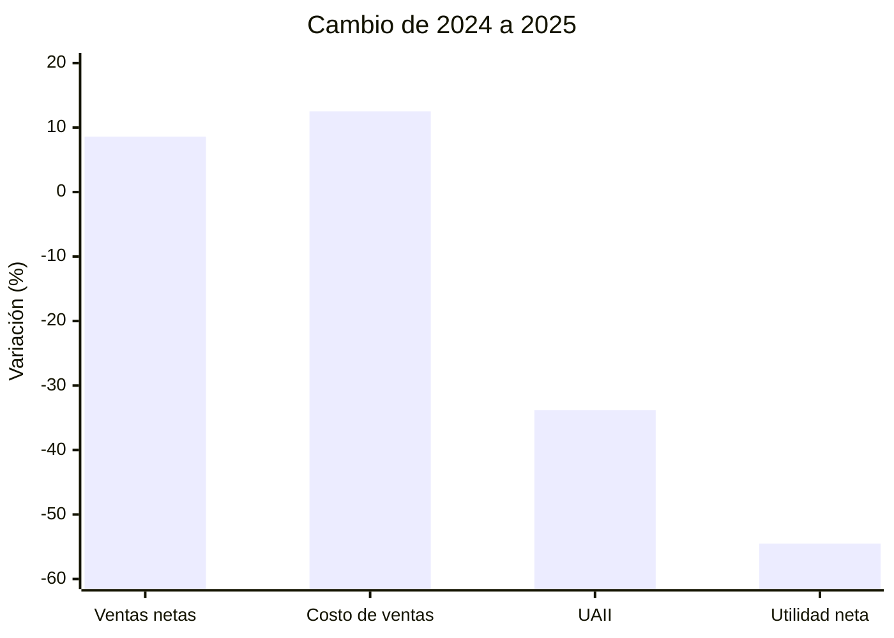
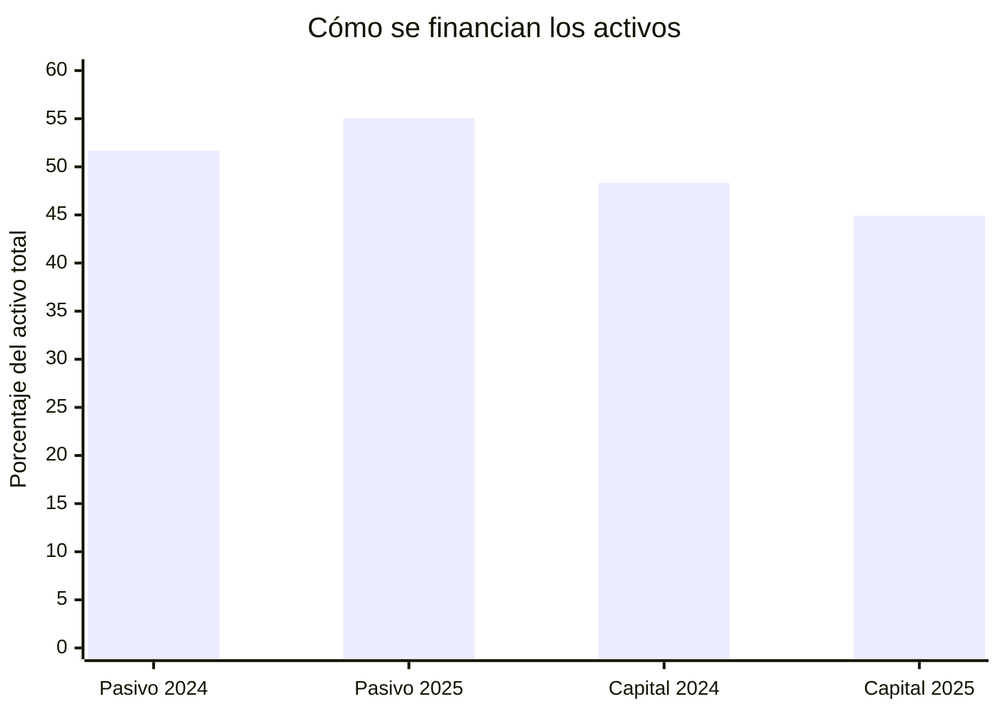

# Industrias Plásticas Altamira, S.A.

**Parcial n.º 3 resuelto y especificación para desarrollar el aplicativo financiero**  
Universidad Tecnológica de Panamá · Facultad de Ingeniería en Sistemas Computacionales · Licenciatura en Gestión y Desarrollo de Software · 8402, Administración Financiera.

[Respuestas del informe](#informe-ejecutivo-y-respuestas) · [Requisitos del aplicativo](#requisitos-del-aplicativo) · [Datos para importar](#datos-de-entrada) · [Razones financieras](#razones-financieras) · [Indicadores complementarios](#indicadores-complementarios)

## Informe ejecutivo y respuestas

Altamira fabrica garrafones de cinco galones y cubetas industriales en Panamá. Todas sus ventas son a crédito. El banco le pide explicar por qué necesita renovar su línea después de un año en que vendió más. En 2025 las ventas netas crecieron **8.58 %**, pero la utilidad neta cayó **54.50 %**, de **USD 458,250 a USD 208,500**. Al cierre había **USD 99,500 menos en caja**. La prioridad es recuperar margen, cobrar más rápido y ajustar las compras de inventario antes de distribuir más dividendos.

La página 8 del parcial contiene siete preguntas y repite el número 1. Las letras siguientes conservan el orden de los enunciados y permiten referirse a cada uno durante la sustentación.

### 4.1.a. Compra de maquinaria, préstamos y dividendos

> En 2025 la empresa compró maquinaria con préstamos. ¿En qué sección del estado de flujo de efectivo aparece cada movimiento? ¿Qué indica el flujo de efectivo libre de 2025 sobre la capacidad de Altamira para pagar dividendos sin endeudarse más?

La compra de maquinaria aparece en **inversión**. La cuenta de maquinaria aumentó de USD 2,850,000 a USD 3,480,000. Como no hubo bajas, se compraron **USD 630,000** de maquinaria. Se compraron también USD 120,000 en equipo de transporte y USD 25,000 en mobiliario. La compra total de activos fijos fue de **USD 775,000**.

El dinero recibido de los préstamos aparece en **financiamiento**. Los documentos por pagar a corto plazo aumentaron USD 170,000 y el préstamo de largo plazo, sumando su porción corriente, aumentó USD 400,000 netos. La operación generó USD 194,500. Después de comprar activos fijos faltaban USD 580,500, incluso antes de pagar dividendos. Con los USD 89,000 efectivamente pagados, el **flujo libre fue −USD 669,500**. En esas condiciones, pagar dividendos requiere consumir caja, vender activos o conseguir financiamiento. Recomendaría posponer nuevas distribuciones mientras persista el déficit.

### 4.1.b. Valor en libros de terrenos y edificios

> El balance general presenta los activos fijos a costo histórico menos depreciación. ¿Por qué el valor en libros de los terrenos y edificios puede ser muy distinto de su valor de mercado? ¿Qué limitación del balance revela esto ante el banco?

El terreno figura por su costo de USD 650,000. Normalmente los terrenos conservan su costo contable sin depreciación, aun cuando la ubicación o la demanda cambien su precio. Los edificios figuran al costo de USD 1,800,000 antes de depreciación. La depreciación distribuye el costo a lo largo de la vida útil. El precio que pagaría un comprador depende además del estado del inmueble y del mercado. El caso presenta la depreciación acumulada de los activos fijos en conjunto, de modo que tampoco permite aislar el valor neto del edificio. Para estimar cuánto recuperaría con esa garantía, el banco necesitaría un avalúo actualizado.

### 4.1.c. Utilidad neta, flujo de operación y caída de caja

> Comparen la utilidad neta con el flujo neto de operación de 2025. ¿Por qué una empresa puede reportar utilidades y aun así tener menos efectivo? ¿Qué decisión de la gerencia explica la mayor parte de la diferencia?

La **utilidad neta fue USD 208,500** y el **flujo de operación fue USD 194,500**. Por cada dólar de utilidad entraron aproximadamente USD 0.93 de efectivo operativo. La venta a crédito genera ingreso al facturar, mientras que el efectivo llega al cobrar. Comprar existencias también puede consumir caja antes de que esas unidades afecten el costo de ventas.

El puente exacto es **USD 208,500 + USD 426,000 de depreciación y amortización − USD 440,000 de capital de trabajo = USD 194,500**. La decisión explícita de relajar el crédito elevó las cuentas por cobrar netas en **USD 267,000**. El mayor uso individual fue el aumento de inventarios, **USD 285,000**. Los dos rubros absorbieron USD 552,000 y el aumento de proveedores compensó USD 125,000. Para explicar la caída de la **caja total** hay que sumar al flujo operativo la inversión de −USD 775,000 y el financiamiento de +USD 481,000. El resultado es −USD 99,500.

### 4.2.a. Las cuatro categorías y el deterioro principal

> Clasifiquen las 13 razones en las cuatro categorías del libro (rentabilidad, utilización de activos, liquidez y utilización de deudas). ¿Qué categoría empeoró más entre 2024 y 2025 y cuál es su causa raíz según el caso?

| Categoría | Razones del parcial | Interpretación de 2024 a 2025 |
| --- | --- | --- |
| Rentabilidad | 1. Margen de utilidad, 2. ROA, 3. ROE | El margen cayó de 5.34 % a 2.24 %, el ROA de 6.56 % a 2.68 % y el ROE de 13.57 % a 5.95 %. |
| Utilización de activos | 4. Rotación de cuentas por cobrar, 5. periodo promedio de cobranza, 6. rotación de inventario, 7. rotación de activos fijos, 8. rotación de activos totales | El cobro pasó de 43.16 a 50.07 días. La rotación del inventario bajó de 7.42 a 6.47 veces y los activos totales produjeron menos ventas por dólar invertido. |
| Liquidez | 9. Razón circulante, 10. razón rápida | La razón circulante bajó de 1.80 a 1.69. La rápida cayó de 1.06 a 0.93, por debajo de un dólar de activos circulantes excluido el inventario por cada dólar de pasivo circulante. |
| Utilización de deudas | 11. Deudas a activos, 12. rotación del interés ganado, 13. cobertura de cargos fijos | La deuda pasó de 51.67 % a 55.07 % de los activos. La cobertura de intereses bajó de 4.75 a 2.42 veces y la de cargos fijos, de 3.00 a 1.82. |

**La rentabilidad empeoró más.** Sus tres razones cayeron entre 56 % y 60 % en términos relativos. El encarecimiento de la resina elevó la presión sobre el costo de materiales, que creció 13.99 %. El costo de ventas subió 12.52 %, frente al 8.58 % de las ventas netas. El margen bruto cayó de 35.01 % a 32.65 %. Además, los gastos de operación crecieron USD 303,000 y los intereses USD 49,000. La expansión de las ventas dejó menos beneficio por dólar.

### 4.2.b. Calidad de las utilidades

> Considerando las pérdidas extraordinarias, el aumento de las cuentas por cobrar y la relajación de la política de crédito, ¿la utilidad de 2025 es de alta o baja calidad? Justifiquen con al menos dos razones financieras.

La utilidad de 2025 es **de menor calidad que la de 2024** y la clasificaría como baja para efectos del análisis crediticio. La rotación de cuentas por cobrar bajó de **8.34 a 7.19 veces**, por debajo de las 8.00 de la industria. El cobro tomó **50.07 días** frente a una referencia de 45. Además, el **margen neto fue 2.24 %**, aproximadamente la mitad del 4.50 % de la industria. La empresa sigue generando efectivo operativo, aunque convirtió en caja el 93.29 % de su utilidad, frente al 160.23 % del año anterior.

Las pérdidas extraordinarias aumentaron de USD 25,000 a USD 38,000. Para evaluar la utilidad recurrente conviene aislarlas. Aun si se excluyeran los USD 38,000 y se aplicara el 25 % de ISR, la utilidad ajustada de 2025 sería **USD 237,000**. La menor rentabilidad y el cobro tardío seguirían presentes.

### 4.2.c. Decisión del banco

> Las razones de cobertura (rotación del interés ganado y cobertura de los cargos fijos) se comparan con el promedio de la industria. Si ustedes fueran el banco, ¿renovarían la línea de crédito? ¿Con qué condiciones?

**Renovaría la línea de capital de trabajo de forma condicionada.** En 2025 la UAII cubrió **2.42 veces** los intereses, frente a **4.50** en la industria. La cobertura de intereses y arrendamientos fue **1.82 veces**, frente a **3.00**. Ambas siguen por encima de 1, pero existe menos holgura ante otra caída de la utilidad. Propondría condicionar la renovación a tres compromisos de la gerencia.

1. Entregar cada mes la antigüedad de las cuentas por cobrar y adoptar un plan para volver a 45 días. A las ventas de 2025, cerrar esa brecha liberaría aproximadamente USD 131,125.
2. Presentar una proyección de caja con cobros, compras, intereses y vencimientos. Revisar trimestralmente los avances hacia las referencias de cobertura de 4.50 y 3.00 veces.
3. Destinar la línea al ciclo de cobros y pagos. Financiar futuras máquinas a plazos acordes con su vida útil y condicionar los dividendos a la recuperación del flujo libre.

### 4.2.d. Du Pont, caída del ROE y medidas correctivas

> Con los resultados del sistema Du Pont, expliquen si la variación del ROE entre 2024 y 2025 se debe principalmente a la operación (margen y rotación) o al financiamiento (endeudamiento), y qué recomendarían a la gerencia para revertirla.

El ROE cayó de **13.57 % a 5.95 %**, una pérdida de **7.62 puntos porcentuales**. Al sustituir sucesivamente margen, rotación y apalancamiento, el menor margen aporta **−7.89 puntos**, la menor rotación **−0.15** y el mayor apalancamiento **+0.42**. El problema se concentra en la **operación**, especialmente en el margen. El aumento de la deuda compensó una pequeña parte de la caída aritmética del ROE y al mismo tiempo elevó la carga de intereses.

Recomendaría revisar el consumo y el costo de resina por producto, renegociar compras y evaluar los precios de garrafones y cubetas con sus márgenes respectivos. Para recuperar rotación, conviene reducir inventarios de baja salida y volver a fijar límites y plazos de crédito por cliente.

## Requisitos del aplicativo

El proyecto es viable en Excel con VBA, Access, Python o una aplicación web. En cualquiera de esas opciones, el menú principal debe abrir las siete pantallas siguientes. Los datos editables son las cuentas y los parámetros. Los estados, las razones, los comentarios numéricos y los gráficos se generan a partir de esos datos.

| Módulo | Qué debe hacer | Resultado que puede comprobar el usuario |
| --- | --- | --- |
| 1. Captura y validación | Recibir saldos 2024, las 50 cuentas antes del cierre de 2025 y los datos complementarios. Conservar 2023 para verificar el flujo base. | Mostrar totales de Debe y Haber, diferencia de balance por año y alertas con su importe. |
| 2. Estado de resultados | Clasificar ventas, devoluciones, costo de ventas, gastos operativos, ingresos financieros, intereses y pérdidas extraordinarias. Calcular ISR y utilidad por acción. | De las ventas brutas al resultado neto, con cada subtotal y el ISR comparado con la cuenta 27. |
| 3. Balance comparativo | Agrupar circulantes, activos fijos netos, otros activos, obligaciones y patrimonio. Cerrar las cuentas temporales de 2025. | Balance 2024–2025 y conciliación de utilidades retenidas. |
| 4. Flujo de efectivo | Aplicar el método indirecto y separar operación, inversión y financiamiento. | Conciliación de caja inicial y final, dividendos pagados y flujo libre según el parcial. |
| 5. Razones y Du Pont | Calcular las 13 razones por año, compararlas con la industria e interpretar las cuatro categorías. | Dos indicadores por razón, uno por año, con sentido favorable, referencia y explicación. ROA y ROE deben coincidir con su cálculo directo. |
| 6. Análisis horizontal y vertical | Calcular cambios absolutos y porcentuales por cuenta, y la participación de cada partida del estado de resultados y del balance en ambos años. | Tablas comparativas y al menos dos gráficos enlazados a los resultados. |
| 7. Indicadores complementarios | Resolver los literales a–g de la consigna. | Escudo fiscal, costos después de ISR, valor por acción y P/U, conciliación por producto, utilidad frente a caja, aportes Du Pont y costo del crédito. |

**Flujo de cálculo.** Al editar una cuenta se clasifica por su identificador, se recalculan el estado de resultados y el cierre de utilidades retenidas, y se reconstruyen el balance, los flujos, las razones y los gráficos. Conservar los datos de la balanza permite volver al caso original y explicar un descuadre durante la sustentación.

## Datos de entrada

| Dato | Valor del caso | Aplicación |
| --- | --- | --- |
| Moneda | Dólares estadounidenses (USD) | En las tablas, la coma separa millares y el punto indica decimales. |
| Acciones comunes y valor nominal | 200,000 acciones en ambos años, USD 5.00 de valor nominal | Capital común de USD 1,000,000. Las medidas por acción usan las 200,000 acciones. |
| ISR y año comercial | 25 % y 360 días | Aplicar el ISR a la utilidad antes de impuestos. Dividir ventas netas entre 360 para la cobranza. |
| Ventas a crédito | 100 % | Usar ventas netas como ventas a crédito en las razones. |
| Productos 2025 | 1,160,000 garrafones a USD 4.50 y 480,000 cubetas a USD 9.00 | Conciliar unidades por precio con la venta bruta de la cuenta 50. |
| Activos fijos e intangibles | En 2025 no hubo ventas ni bajas | Calcular compras con el aumento del costo bruto. |
| Efectivo e inversiones | Solo Caja y bancos es efectivo | Llevar las variaciones de valores negociables e inversiones a largo plazo a inversión. |
| Cobertura de cargos fijos | El arrendamiento es el único cargo fijo adicional al interés | Usar UAII de operación. Sumar el arrendamiento al numerador y al denominador. |
| Precio de mercado por acción | Sin dato en 2024 y 2025 | Admitir un precio opcional por año para calcular P/U. Mostrar el motivo cuando falte. |

### Catálogo y saldos importables

El bloque CSV conserva los identificadores y el orden de las 50 cuentas de la balanza. Las columnas de 2023 y 2024 contienen **magnitudes positivas por su naturaleza**. Una celda vacía en 2023 indica que el caso solo aporta saldos de balance de ese año. En 2025 cada valor está en la columna real de Debe o Haber. `D` significa deudora y `H`, acreedora.

```csv
id,cuenta,grupo,naturaleza,saldo_2023,saldo_2024,debe_2025,haber_2025
1,Activos intangibles (software y licencias),otros_activos,D,320000,350000,410000,0
2,Amortización acumulada de intangibles,amort_acumulada,H,110000,150000,0,194000
3,Arrendamientos,gasto_operativo,D,,144000,156000,0
4,Bonos por pagar,pasivo_largo,H,800000,800000,0,800000
5,Caja y bancos,activo_corriente,D,310000,437250,337750,0
6,Capital común,capital,H,1000000,1000000,0,1000000
7,Capital pagado en exceso del valor nominal,capital,H,400000,400000,0,400000
8,Costo de materiales,costo_ventas,D,,3430000,3910000,0
9,Costos indirectos de fabricación,costo_ventas,D,,857000,946000,0
10,Cuentas por cobrar comerciales,activo_corriente,D,980000,1060000,1335000,0
11,Cuentas por pagar a proveedores,pasivo_corriente,H,610000,655000,0,780000
12,Depreciación acumulada,deprec_acumulada,H,1950000,2280000,0,2662000
13,Devoluciones y descuentos sobre ventas,devoluciones,D,,175000,229000,0
14,Dividendos decretados,dividendo,D,,183000,83000,0
15,Dividendos por pagar,pasivo_corriente,H,40000,46000,0,40000
16,Documentos por pagar (préstamo bancario a corto plazo),pasivo_corriente,H,300000,350000,0,520000
17,Edificios,activo_fijo,D,1800000,1800000,1800000,0
18,Equipo de transporte,activo_fijo,D,420000,480000,600000,0
19,Estimación para cuentas incobrables,correctora_cxc,H,29000,32000,0,40000
20,Fletes y distribución,gasto_operativo,D,,215000,248000,0
21,Gasto por amortización de intangibles,gasto_operativo,D,,40000,44000,0
22,Gasto por depreciación,gasto_operativo,D,,330000,382000,0
23,Gastos acumulados por pagar,pasivo_corriente,H,185000,198000,0,214000
24,Gastos pagados por anticipado,activo_corriente,D,60000,65000,72000,0
25,Gastos por intereses,intereses,D,,165000,214000,0
26,Honorarios profesionales,gasto_operativo,D,,52000,61000,0
27,Impuesto sobre la renta del periodo,isr_periodo,D,,152750,69500,0
28,Impuesto sobre la renta por pagar,pasivo_corriente,H,95000,110000,0,88000
29,Ingresos financieros,ingreso_financiero,H,,18000,0,12000
30,Inventario de materia prima,activo_corriente,D,410000,445000,540000,0
31,Inventario de productos en proceso,activo_corriente,D,140000,150000,165000,0
32,Inventario de productos terminados,activo_corriente,D,520000,560000,735000,0
33,Inversiones a largo plazo,otros_activos,D,250000,250000,250000,0
34,Mano de obra directa,costo_ventas,D,,1286000,1415000,0
35,Mantenimiento,gasto_operativo,D,,86000,104000,0
36,Maquinaria y equipo,activo_fijo,D,2600000,2850000,3480000,0
37,Mobiliario y equipo de oficina,activo_fijo,D,210000,230000,255000,0
38,Otros gastos generales,gasto_operativo,D,,48000,57000,0
39,Pérdidas extraordinarias,perdida_extra,D,,25000,38000,0
40,Porción corriente de la deuda a largo plazo,pasivo_corriente,H,200000,200000,0,250000
41,Préstamo bancario a largo plazo,pasivo_largo,H,1400000,1250000,0,1600000
42,Publicidad y mercadeo,gasto_operativo,D,,172000,215000,0
43,Seguros,gasto_operativo,D,,64000,70000,0
44,Servicios públicos,gasto_operativo,D,,118000,131000,0
45,Sueldos administrativos,gasto_operativo,D,,520000,566000,0
46,Sueldos y comisiones de ventas,gasto_operativo,D,,430000,488000,0
47,Terrenos,activo_fijo,D,650000,650000,650000,0
48,Utilidades retenidas,retenidas,H,1701000,1976250,0,1976250
49,Valores negociables,activo_corriente,D,150000,120000,60000,0
50,Ventas brutas,ventas,H,,8750000,0,9540000
```

**Cuentas que requieren tratamiento específico.** Las cuentas 2, 12 y 19 reducen el activo que corrigen. La 13 reduce ventas. La 14 representa dividendos declarados y la 15 recoge el saldo pendiente de pago. La cuenta 27 permite verificar el impuesto calculado a partir de la utilidad antes de impuestos. El ISR se descuenta una sola vez. En la fila 48, las columnas 2023 y 2024 contienen saldos **de cierre**, mientras el Haber de 2025 contiene el saldo **de apertura**. El balance de 2025 usa el saldo posterior al cierre.

**Controles de carga.** La balanza de 2025 suma **USD 20,116,250** por cada lado. Para 2023, el activo circulante es USD 2,541,000, los activos fijos netos son USD 3,730,000 y los otros activos netos son USD 460,000. El activo total de USD 6,731,000 se financia con USD 3,630,000 de pasivos y USD 3,101,000 de capital. El estado de flujo de 2024 parte de USD 310,000 en caja al cierre de 2023.

### Reglas de cálculo por identificador de cuenta

En estas expresiones, `c[n]` es el importe de la cuenta en su lado natural para el año elegido. `Δc[n]` es su saldo final menos su saldo inicial. Para el flujo se calcula primero la variación de la cartera neta y la del inventario total.

| Salida del motor | Operación sobre las cuentas |
| --- | --- |
| Ventas netas y costo de ventas | `VN = c[50] − c[13]`. `Costo = c[8] + c[34] + c[9]`. |
| UAII, utilidad antes de impuestos y utilidad neta | `UAII = VN − Costo − suma(grupo gasto_operativo)`. `UAI = UAII + c[29] − c[25] − c[39]`. `UN = UAI − ISR calculado`. |
| Cartera, inventario y activo circulante | `Cartera = c[10] − c[19]`. `Inventario = c[30] + c[31] + c[32]`. `AC = c[5] + c[49] + Cartera + Inventario + c[24]`. |
| Activo fijo y otros activos | `Fijo bruto = c[47] + c[17] + c[36] + c[18] + c[37]`. `Fijo neto = Fijo bruto − c[12]`. `Otros activos = c[1] − c[2] + c[33]`. |
| Pasivos y capital | `PC = c[11] + c[16] + c[23] + c[28] + c[40] + c[15]`. `PLP = c[41] + c[4]`. `Capital = c[6] + c[7] + retenidas al cierre`. |
| Flujo de operación | `UN + c[22] + c[21] − ΔCartera − ΔInventario − Δc[24] + Δc[11] + Δc[23] + Δc[28]`. |
| Flujo de inversión | `−Compras de fijos − Compras de intangibles − Δc[49] − Δc[33]`. Una disminución en valores negociables genera una entrada. |
| Flujo de financiamiento en el caso | `Δc[16] + Δc[40] + Δc[41] + Δc[4] − dividendos pagados`. El capital aportado se mantuvo constante en ambos años. |

## Estados financieros y análisis comparativo

Todas las cifras monetarias de estas tablas se expresan en USD. El **análisis horizontal** calcula `Δ USD = importe 2025 − importe 2024` y `Δ % = Δ USD / importe 2024 × 100`. Si la base es cero, se presenta «N/D» junto al cambio absoluto. En las cuentas correctoras se conserva el signo del estado. Por ejemplo, las devoluciones pasan de −175,000 a −229,000, un cambio de −54,000 y un aumento de 30.86 % en su magnitud.

El **análisis vertical** divide cada partida por las ventas netas de su año en el estado de resultados y por el activo total de su año en el balance. Las partidas de costo, gasto operativo e ISR se presentan por su importe y se deducen al calcular los subtotales. Los valores de referencia se presentan redondeados. El aplicativo debe conservar precisión en las divisiones y redondear únicamente los resultados mostrados, salvo el registro monetario del impuesto al centavo.

### Estado de resultados al 31 de diciembre

| Partida | 2024 | 2025 | Δ USD | Δ % | % ventas 2024 | % ventas 2025 |
| --- | ---: | ---: | ---: | ---: | ---: | ---: |
| Ventas brutas | 8,750,000 | 9,540,000 | 790,000 | 9.03 % | 102.04 % | 102.46 % |
| Devoluciones y descuentos sobre ventas | −175,000 | −229,000 | −54,000 | 30.86 % | −2.04 % | −2.46 % |
| **Ventas netas** | **8,575,000** | **9,311,000** | **736,000** | **8.58 %** | **100.00 %** | **100.00 %** |
| Costo de materiales | 3,430,000 | 3,910,000 | 480,000 | 13.99 % | 40.00 % | 41.99 % |
| Mano de obra directa | 1,286,000 | 1,415,000 | 129,000 | 10.03 % | 15.00 % | 15.20 % |
| Costos indirectos de fabricación | 857,000 | 946,000 | 89,000 | 10.39 % | 9.99 % | 10.16 % |
| **Costo de ventas** | **5,573,000** | **6,271,000** | **698,000** | **12.52 %** | **64.99 %** | **67.35 %** |
| **Utilidad bruta** | **3,002,000** | **3,040,000** | **38,000** | **1.27 %** | **35.01 %** | **32.65 %** |
| Sueldos administrativos | 520,000 | 566,000 | 46,000 | 8.85 % | 6.06 % | 6.08 % |
| Sueldos y comisiones de ventas | 430,000 | 488,000 | 58,000 | 13.49 % | 5.01 % | 5.24 % |
| Publicidad y mercadeo | 172,000 | 215,000 | 43,000 | 25.00 % | 2.01 % | 2.31 % |
| Arrendamientos | 144,000 | 156,000 | 12,000 | 8.33 % | 1.68 % | 1.68 % |
| Servicios públicos | 118,000 | 131,000 | 13,000 | 11.02 % | 1.38 % | 1.41 % |
| Seguros | 64,000 | 70,000 | 6,000 | 9.38 % | 0.75 % | 0.75 % |
| Mantenimiento | 86,000 | 104,000 | 18,000 | 20.93 % | 1.00 % | 1.12 % |
| Honorarios profesionales | 52,000 | 61,000 | 9,000 | 17.31 % | 0.61 % | 0.66 % |
| Fletes y distribución | 215,000 | 248,000 | 33,000 | 15.35 % | 2.51 % | 2.66 % |
| Otros gastos generales | 48,000 | 57,000 | 9,000 | 18.75 % | 0.56 % | 0.61 % |
| Gasto por depreciación | 330,000 | 382,000 | 52,000 | 15.76 % | 3.85 % | 4.10 % |
| Gasto por amortización de intangibles | 40,000 | 44,000 | 4,000 | 10.00 % | 0.47 % | 0.47 % |
| **Gastos de operación** | **2,219,000** | **2,522,000** | **303,000** | **13.65 %** | **25.88 %** | **27.09 %** |
| **Utilidad de operación (UAII)** | **783,000** | **518,000** | **−265,000** | **−33.84 %** | **9.13 %** | **5.56 %** |
| Ingresos financieros | 18,000 | 12,000 | −6,000 | −33.33 % | 0.21 % | 0.13 % |
| Gastos por intereses | −165,000 | −214,000 | −49,000 | 29.70 % | −1.92 % | −2.30 % |
| Pérdidas extraordinarias | −25,000 | −38,000 | −13,000 | 52.00 % | −0.29 % | −0.41 % |
| **Utilidad antes de impuestos** | **611,000** | **278,000** | **−333,000** | **−54.50 %** | **7.13 %** | **2.99 %** |
| **ISR del periodo** | **152,750** | **69,500** | **−83,250** | **−54.50 %** | **1.78 %** | **0.75 %** |
| **Utilidad neta** | **458,250** | **208,500** | **−249,750** | **−54.50 %** | **5.34 %** | **2.24 %** |

**Utilidad por acción.** USD 458,250 / 200,000 = **USD 2.29 en 2024** y USD 208,500 / 200,000 = **USD 1.04 en 2025**. Para programar el estado, la UAII equivale a utilidad bruta menos gastos de operación. La utilidad antes de impuestos equivale a UAII más ingresos financieros, menos intereses y pérdidas extraordinarias.

### Balance general al 31 de diciembre

| Partida | 2024 | 2025 | Δ USD | Δ % | % activo 2024 | % activo 2025 |
| --- | ---: | ---: | ---: | ---: | ---: | ---: |
| Caja y bancos | 437,250 | 337,750 | −99,500 | −22.76 % | 6.26 % | 4.33 % |
| Valores negociables | 120,000 | 60,000 | −60,000 | −50.00 % | 1.72 % | 0.77 % |
| Cuentas por cobrar comerciales | 1,060,000 | 1,335,000 | 275,000 | 25.94 % | 15.17 % | 17.13 % |
| Estimación para cuentas incobrables | −32,000 | −40,000 | −8,000 | 25.00 % | −0.46 % | −0.51 % |
| **Cuentas por cobrar netas** | **1,028,000** | **1,295,000** | **267,000** | **25.97 %** | **14.72 %** | **16.62 %** |
| Inventario de materia prima | 445,000 | 540,000 | 95,000 | 21.35 % | 6.37 % | 6.93 % |
| Inventario de productos en proceso | 150,000 | 165,000 | 15,000 | 10.00 % | 2.15 % | 2.12 % |
| Inventario de productos terminados | 560,000 | 735,000 | 175,000 | 31.25 % | 8.02 % | 9.43 % |
| **Inventario total** | **1,155,000** | **1,440,000** | **285,000** | **24.68 %** | **16.53 %** | **18.48 %** |
| Gastos pagados por anticipado | 65,000 | 72,000 | 7,000 | 10.77 % | 0.93 % | 0.92 % |
| **Activos circulantes** | **2,805,250** | **3,204,750** | **399,500** | **14.24 %** | **40.16 %** | **41.12 %** |
| Terrenos | 650,000 | 650,000 | 0 | 0.00 % | 9.31 % | 8.34 % |
| Edificios | 1,800,000 | 1,800,000 | 0 | 0.00 % | 25.77 % | 23.10 % |
| Maquinaria y equipo | 2,850,000 | 3,480,000 | 630,000 | 22.11 % | 40.80 % | 44.65 % |
| Equipo de transporte | 480,000 | 600,000 | 120,000 | 25.00 % | 6.87 % | 7.70 % |
| Mobiliario y equipo de oficina | 230,000 | 255,000 | 25,000 | 10.87 % | 3.29 % | 3.27 % |
| **Activos fijos al costo** | **6,010,000** | **6,785,000** | **775,000** | **12.90 %** | **86.04 %** | **87.06 %** |
| Depreciación acumulada | −2,280,000 | −2,662,000 | −382,000 | 16.75 % | −32.64 % | −34.16 % |
| **Activos fijos netos** | **3,730,000** | **4,123,000** | **393,000** | **10.54 %** | **53.40 %** | **52.90 %** |
| Activos intangibles (software y licencias) | 350,000 | 410,000 | 60,000 | 17.14 % | 5.01 % | 5.26 % |
| Amortización acumulada de intangibles | −150,000 | −194,000 | −44,000 | 29.33 % | −2.15 % | −2.49 % |
| Inversiones a largo plazo | 250,000 | 250,000 | 0 | 0.00 % | 3.58 % | 3.21 % |
| **Otros activos netos** | **450,000** | **466,000** | **16,000** | **3.56 %** | **6.44 %** | **5.98 %** |
| **Total activos** | **6,985,250** | **7,793,750** | **808,500** | **11.57 %** | **100.00 %** | **100.00 %** |
| Cuentas por pagar a proveedores | 655,000 | 780,000 | 125,000 | 19.08 % | 9.38 % | 10.01 % |
| Documentos por pagar (préstamo bancario a corto plazo) | 350,000 | 520,000 | 170,000 | 48.57 % | 5.01 % | 6.67 % |
| Gastos acumulados por pagar | 198,000 | 214,000 | 16,000 | 8.08 % | 2.83 % | 2.75 % |
| Impuesto sobre la renta por pagar | 110,000 | 88,000 | −22,000 | −20.00 % | 1.57 % | 1.13 % |
| Porción corriente de la deuda a largo plazo | 200,000 | 250,000 | 50,000 | 25.00 % | 2.86 % | 3.21 % |
| Dividendos por pagar | 46,000 | 40,000 | −6,000 | −13.04 % | 0.66 % | 0.51 % |
| **Pasivos circulantes** | **1,559,000** | **1,892,000** | **333,000** | **21.36 %** | **22.32 %** | **24.28 %** |
| Préstamo bancario a largo plazo | 1,250,000 | 1,600,000 | 350,000 | 28.00 % | 17.89 % | 20.53 % |
| Bonos por pagar | 800,000 | 800,000 | 0 | 0.00 % | 11.45 % | 10.26 % |
| **Pasivos a largo plazo** | **2,050,000** | **2,400,000** | **350,000** | **17.07 %** | **29.35 %** | **30.79 %** |
| **Total pasivos** | **3,609,000** | **4,292,000** | **683,000** | **18.92 %** | **51.67 %** | **55.07 %** |
| Capital común | 1,000,000 | 1,000,000 | 0 | 0.00 % | 14.32 % | 12.83 % |
| Capital pagado en exceso del valor nominal | 400,000 | 400,000 | 0 | 0.00 % | 5.73 % | 5.13 % |
| **Utilidades retenidas al cierre** | **1,976,250** | **2,101,750** | **125,500** | **6.35 %** | **28.29 %** | **26.97 %** |
| **Capital contable** | **3,376,250** | **3,501,750** | **125,500** | **3.72 %** | **48.33 %** | **44.93 %** |
| **Total pasivos y capital contable** | **6,985,250** | **7,793,750** | **808,500** | **11.57 %** | **100.00 %** | **100.00 %** |

**Cierre de utilidades retenidas.** En 2024, USD 1,701,000 + USD 458,250 − USD 183,000 = **USD 1,976,250**. En 2025, USD 1,976,250 + USD 208,500 − USD 83,000 = **USD 2,101,750**. Para completar la comparación de las cuentas de la balanza previa al cierre se incluyen aquí los dos movimientos de patrimonio correspondientes.

| Partida adicional de la balanza | 2024 | 2025 | Δ USD | Δ % |
| --- | ---: | ---: | ---: | ---: |
| 14. Dividendos declarados | 183,000 | 83,000 | −100,000 | −54.64 % |
| 48. Utilidades retenidas al inicio | 1,701,000 | 1,976,250 | +275,250 | +16.18 % |

### Estado de flujo de efectivo por el método indirecto

El signo positivo indica una entrada de efectivo o un ajuste que aumenta el flujo. El signo negativo indica una salida o un ajuste que lo reduce. Para los activos corrientes operativos se usa saldo inicial menos final. Para los pasivos operativos se usa saldo final menos inicial.

| Partida (USD) | 2024 | 2025 |
| --- | ---: | ---: |
| **Actividades de operación** |  |  |
| Utilidad neta | 458,250 | 208,500 |
| Depreciación | 330,000 | 382,000 |
| Amortización de intangibles | 40,000 | 44,000 |
| Variación de cuentas por cobrar netas | −77,000 | −267,000 |
| Variación de inventarios | −85,000 | −285,000 |
| Variación de pagos anticipados | −5,000 | −7,000 |
| Variación de proveedores | 45,000 | 125,000 |
| Variación de gastos acumulados por pagar | 13,000 | 16,000 |
| Variación de ISR por pagar | 15,000 | −22,000 |
| **Flujo neto de operación** | **734,250** | **194,500** |
| **Actividades de inversión** |  |  |
| Compra de activos fijos | −330,000 | −775,000 |
| Compra de intangibles | −30,000 | −60,000 |
| Venta neta de valores negociables | 30,000 | 60,000 |
| Movimiento neto de inversiones a largo plazo | 0 | 0 |
| **Flujo neto de inversión** | **−330,000** | **−775,000** |
| **Actividades de financiamiento** |  |  |
| Aumento de documentos por pagar a corto plazo | 50,000 | 170,000 |
| Préstamo a largo plazo, incluida su porción corriente (movimiento neto) | −150,000 | 400,000 |
| Movimiento de bonos por pagar | 0 | 0 |
| Dividendos pagados | −177,000 | −89,000 |
| **Flujo neto de financiamiento** | **−277,000** | **481,000** |
| **Variación neta de caja y bancos** | **127,250** | **−99,500** |
| Caja y bancos al inicio | 310,000 | 437,250 |
| **Caja y bancos al cierre** | **437,250** | **337,750** |
| **Flujo de efectivo libre según el parcial** | **227,250** | **−669,500** |

Los **dividendos pagados** se obtienen sumando los declarados y el saldo inicial por pagar, y restando el saldo final por pagar. En 2025, USD 83,000 + USD 46,000 − USD 40,000 = **USD 89,000**. La deuda bancaria de largo plazo suma la porción corriente y la no corriente antes de comparar saldos. Así una reclasificación por vencimiento tiene efecto de caja cero. El **flujo libre** usa la definición del parcial, `flujo de operación − compras de activos fijos tangibles − dividendos pagados`.

### Dos gráficos para el módulo de análisis

**Gráfico horizontal.** Mostrar la variación porcentual de ventas netas, costo de ventas, UAII y utilidad neta. La escala debe permitir barras negativas. El contraste entre ventas y utilidad permite ver el efecto de los costos y gastos.



**Gráfico vertical.** Mostrar qué porcentaje de los activos financian los pasivos y qué porcentaje financia el capital contable en cada año. Los dos porcentajes de cada año deben sumar 100 %. Ambos gráficos deben leer las tablas calculadas al cambiar cualquier cuenta.



## Razones financieras

Usar **saldos al cierre de cada año**. VN = ventas netas, UN = utilidad neta, AT = activo total, AC = activo circulante y PC = pasivo circulante. Las cuentas por cobrar (CxC) se toman netas de la estimación. Para las cuatro rotaciones de activos, incluida la de inventario, el numerador es ventas netas, conforme a la página 7 del parcial. La razón rápida aplica la fórmula del ejemplo Saxton y conserva los anticipos dentro de AC al restar el inventario.

**Indicadores de comparación.** 🟢 Favorable, 🟡 igual a la referencia, 🔴 desfavorable y ⚪ sin datos suficientes. La columna «Favorable» indica en qué dirección mejora cada razón. Comparar antes de redondear. En pantalla, acompañar el color con su significado.

| N.º | Razón | Fórmula | 2024 | 2025 | Industria | Favorable |
| --- | --- | --- | --- | --- | --- | --- |
| 1 | Margen de utilidad | UN / VN | 5.34 % 🟢 | 2.24 % 🔴 | 4.50 % | Mayor |
| 2 | Rendimiento sobre activos (ROA) | UN / AT | 6.56 % 🟢 | 2.68 % 🔴 | 5.50 % | Mayor |
| 3 | Rendimiento sobre capital contable (ROE) | UN / capital contable | 13.57 % 🟢 | 5.95 % 🔴 | 11.50 % | Mayor |
| 4 | Rotación de cuentas por cobrar | VN / CxC netas | 8.34× 🟢 | 7.19× 🔴 | 8.00× | Mayor |
| 5 | Periodo promedio de cobranza (PPC) | CxC netas / (VN / 360) | 43.16 días 🟢 | 50.07 días 🔴 | 45.00 días | Menor |
| 6 | Rotación de inventario | VN / inventario total | 7.42× 🟢 | 6.47× 🔴 | 7.00× | Mayor |
| 7 | Rotación de activos fijos | VN / activos fijos netos | 2.30× 🔴 | 2.26× 🔴 | 2.40× | Mayor |
| 8 | Rotación de activos totales | VN / AT | 1.23× 🔴 | 1.19× 🔴 | 1.25× | Mayor |
| 9 | Razón circulante | AC / PC | 1.80× 🔴 | 1.69× 🔴 | 1.90× | Mayor |
| 10 | Razón rápida | (AC − inventario total) / PC | 1.06× 🔴 | 0.93× 🔴 | 1.10× | Mayor |
| 11 | Deudas a activos totales | Pasivo total / AT | 51.67 % 🔴 | 55.07 % 🔴 | 50.00 % | Menor |
| 12 | Rotación del interés ganado | UAII / intereses | 4.75× 🟢 | 2.42× 🔴 | 4.50× | Mayor |
| 13 | Cobertura de cargos fijos | (UAII + arrendamientos) / (intereses + arrendamientos) | 3.00× 🟡 | 1.82× 🔴 | 3.00× | Mayor |

La tabla de cuatro categorías de la respuesta 4.2.a contiene las interpretaciones del caso base. Si se cambian las entradas, actualizar el comentario de cada categoría a partir de la variación anual y de la comparación con la industria. Las fórmulas de razón rápida y de rotación también se ilustran en el material de Block y Hirt sobre Saxton. [Referencia metodológica, capítulo 3, cuadros T 3-6 a T 3-8](https://studylib.net/doc/5728618/lesson-5-financial-analysis)

## Indicadores complementarios

### a. Escudo fiscal de la depreciación y amortización

La depreciación de USD 382,000 ahorró **USD 95,500** de ISR. La amortización de USD 44,000 ahorró **USD 11,000**. El gasto sin salida de efectivo fue USD 426,000 y el **escudo total fue USD 106,500**.

| Escenario 2025 (USD) | Con los gastos registrados | Sin depreciación ni amortización |
| --- | ---: | ---: |
| Utilidad antes de impuestos | 278,000 | 704,000 |
| ISR al 25 % | 69,500 | 176,000 |
| Utilidad neta | 208,500 | **528,000** |
| Depreciación y amortización que se suman en el flujo | 426,000 | 0 |
| Ajuste neto por capital de trabajo | −440,000 | −440,000 |
| Flujo neto de operación | 194,500 | **88,000** |

El escenario mantiene iguales las variaciones del capital de trabajo, incluida la del ISR por pagar. Al eliminar estos gastos, la empresa mostraría USD 319,500 más de utilidad y pagaría USD 106,500 más de impuestos. Esta última cifra explica por qué disminuiría el efectivo operativo.

### b. Costo de intereses y arrendamientos después del ISR

El costo después de impuestos es `gasto × (1 − 0.25)`, con la deducción supuesta en el ejercicio.

| Gasto 2025 | Antes de ISR (USD) | Ahorro fiscal (USD) | Después de ISR (USD) |
| --- | ---: | ---: | ---: |
| Intereses | 214,000 | 53,500 | **160,500** |
| Arrendamientos | 156,000 | 39,000 | **117,000** |
| Total | 370,000 | 92,500 | 277,500 |

### c. Valor en libros, utilidad, dividendo y relación precio/utilidad

| Medida | Fórmula | 2024 | 2025 |
| --- | --- | ---: | ---: |
| Valor en libros por acción | Capital contable / acciones comunes | **USD 16.88** | **USD 17.51** |
| Utilidad por acción (UPA) | Utilidad neta / acciones comunes | USD 2.29 | USD 1.04 |
| Dividendo por acción | Dividendos declarados / acciones comunes | USD 0.92 | USD 0.42 |
| Relación precio/utilidad (P/U) | Precio de mercado por acción / UPA sin redondear | N/D | N/D |

El valor en libros aumentó porque parte de la utilidad se retuvo, aun cuando la utilidad y el dividendo por acción bajaron. Para P/U falta el **precio de mercado por acción de cada año**. Si se ingresa, calcular `precio_2024 / 2.29125` o `precio_2025 / 1.0425` para el caso base. El valor nominal de USD 5.00 corresponde al capital común y no proporciona la cotización de mercado.

### d. Conciliación de ventas por producto

| Producto | Unidades 2025 | Precio unitario | Venta bruta (USD) | Participación |
| --- | ---: | ---: | ---: | ---: |
| Garrafones de 5 galones | 1,160,000 | USD 4.50 | 5,220,000 | 54.72 % |
| Cubetas industriales | 480,000 | USD 9.00 | 4,320,000 | 45.28 % |
| Total | 1,640,000 | | **9,540,000** | **100.00 %** |

La diferencia con la cuenta 50 es **USD 0**. Al descontar las devoluciones y descuentos de USD 229,000 se obtienen ventas netas por **USD 9,311,000**. Calcular la participación de cada producto sobre la venta bruta total.

### e. Utilidad neta frente a flujo de operación

| Año | Utilidad neta | Flujo de operación | Flujo menos utilidad | Tres mayores ajustes de capital de trabajo, por valor absoluto |
| --- | ---: | ---: | ---: | --- |
| 2024 | 458,250 | 734,250 | **+276,000** | Inventarios (−85,000), CxC netas (−77,000) y proveedores (+45,000). |
| 2025 | 208,500 | 194,500 | **−14,000** | Inventarios (−285,000), CxC netas (−267,000) y proveedores (+125,000). |

En 2024, los cargos sin salida de caja sumaron USD 370,000 y el capital de trabajo absorbió USD 94,000. En 2025, los cargos fueron USD 426,000 y el capital de trabajo absorbió USD 440,000. Ordenar los ajustes por su valor absoluto y conservar el signo al mostrarlos permite identificar tanto usos como fuentes de efectivo.

### f. Du Pont descompuesto

Definir `m = utilidad neta / ventas netas`, `t = ventas netas / activos totales`, `d = pasivos totales / activos totales` y `L = 1 / (1 − d) = activos totales / capital contable`. Entonces **ROA = m × t** y **ROE = ROA / (1 − d) = m × t × L**.

| Factor | 2024 | 2025 |
| --- | ---: | ---: |
| Margen neto, m | 5.34 % | 2.24 % |
| Rotación de activos totales, t | 1.2276 | 1.1947 |
| Deudas / activos, d | 51.67 % | 55.07 % |
| Multiplicador del capital, L | 2.0689 | 2.2257 |
| ROA | 6.56 % | 2.68 % |
| ROE | 13.57 % | 5.95 % |

Para repartir la variación se adopta el orden **margen → rotación → apalancamiento**. Se reemplaza un factor de 2024 por su valor de 2025 en cada paso y se conservan las cifras completas para que la suma coincida con el cambio de ROE. Los aportes están expresados en puntos porcentuales (p.p.).

| Cambio atribuido a | Fórmula de sustitución | Aporte al ROE |
| --- | --- | ---: |
| Margen | (m₂₅ − m₂₄) × t₂₄ × L₂₄ | −7.89 p.p. |
| Rotación de activos | m₂₅ × (t₂₅ − t₂₄) × L₂₄ | −0.15 p.p. |
| Apalancamiento | m₂₅ × t₂₅ × (L₂₅ − L₂₄) | +0.42 p.p. |
| **Variación total del ROE** | ROE₂₅ − ROE₂₄ | −7.62 p.p. |

### g. Costo de la política de crédito

En 2025, las CxC netas fueron USD 1,335,000 − USD 40,000 = **USD 1,295,000**. Las ventas netas diarias fueron USD 9,311,000 / 360 = **USD 25,863.89** y el PPC fue **50.07 días**. A los 45 días de la industria, la cartera sería USD 9,311,000 × 45 / 360 = **USD 1,163,875**.

**Efectivo adicional inmovilizado = USD 1,295,000 − USD 1,163,875 = USD 131,125.** Se obtiene el mismo resultado con `(PPC real − 45) × ventas netas diarias` usando el PPC y las ventas diarias sin redondear. Es capital pendiente de cobro. Para calcular intereses sobre ese capital haría falta una tasa de financiamiento.

## Manual breve y pruebas de aceptación

### Manual de uso previsto

1. Abrir el menú principal y seleccionar **Captura**. Cargar los saldos base, las 50 cuentas de 2025 y los parámetros de acciones, ISR, días, productos e industria.
2. Revisar las diferencias de **Debe y Haber**, **Activos menos pasivos y capital** y **Ventas por productos menos ventas brutas**. Si aparece una alerta, revisar el importe, el lado contable y la contrapartida de la cuenta modificada.
3. Abrir **Resultados**, **Balance** y **Flujo de efectivo**. Verificar el cierre de retenidas y el puente entre caja inicial y final.
4. Abrir **Razones**, **Análisis horizontal y vertical** e **Indicadores complementarios**. Seleccionar el año o la cuenta que se desea explicar. Los gráficos y comentarios deben reflejar la última edición.
5. Para la sustentación, conservar una copia del caso base, modificar una entrada, explicar el efecto previsto y comparar los resultados recalculados. Volver a la copia base para la siguiente demostración.

### Pruebas concretas para el desarrollo

| Prueba | Acción | Resultado esperado |
| --- | --- | --- |
| Carga completa | Importar el CSV y los parámetros. | 50 identificadores únicos. Debe = Haber = USD 20,116,250. Informar cualquier cuenta ausente o repetida. |
| Validación histórica | Generar los estados 2024 con el cierre 2023. | Reproducir cada renglón de las tablas. UN USD 458,250, activos USD 6,985,250, operación USD 734,250, caja final USD 437,250 y flujo libre USD 227,250. |
| Cierre de 2025 | Ejecutar los módulos 2 y 3. | ISR calculado = cuenta 27 = USD 69,500. UN USD 208,500, retenidas USD 2,101,750 y activos = pasivos + capital = USD 7,793,750. |
| Flujos y ventas | Consultar caja y conciliación por producto. | Flujos USD 194,500, −USD 775,000 y +USD 481,000. Caja final USD 337,750. Ventas brutas por producto USD 9,540,000. Ambas conciliaciones tienen diferencia cero. |
| Descuadre visible | Aumentar solo en USD 100,000 las CxC comerciales de 2025. | Alertas por USD 100,000 en balanza y balance. Mantener visibles la cuenta editada y el importe de la diferencia. |
| Simulación de cobro | Desde la base, aumentar en USD 100,000 las CxC comerciales y reducir caja en la misma suma. Mantener ventas y estimación. | Los activos totales y la utilidad se mantienen. La rotación de CxC baja a 6.67 veces, el PPC sube a 53.94 días, el flujo operativo baja a USD 94,500 y la caja final queda en USD 237,750. |
| Simulación de intereses | Desde la base, subir en USD 10,000 los intereses pagados. Reflejar en caja el pago y el ahorro fiscal inmediato de USD 2,500. Actualizar el ISR de control de la cuenta 27. | Caja −USD 7,500, UAII USD 518,000, ISR USD 67,000 y utilidad neta USD 201,000. La cobertura de intereses baja a 2.31 veces y la de cargos fijos a 1.77. |
| Ratios y semáforo | Comparar ambos años con los 13 promedios. | La cobertura de cargos fijos de 2024 coincide con 3.00 y se marca en amarillo. En el caso base, las 13 razones de 2025 quedan del lado desfavorable. |
| Precio y divisor | Dejar el precio de mercado vacío. Después, como prueba, ingresar USD 20.85 en 2025. Probar además una base cero en una división. | P/U pasa de «N/D · falta precio de mercado» a 20.00 veces con la UPA completa. Un divisor cero produce «N/D» y su motivo. |
| Gráficos y Du Pont | Cambiar una entrada y volver al caso base. | Barras y comentarios se actualizan en ambas direcciones. En la base, los aportes de Du Pont suman −7.62 puntos y el ROE coincide con UN / capital. |

Las comparaciones monetarias se hacen al centavo. Para las razones y el costo del crédito se conserva la precisión hasta el final. Ante un descuadre, informar por separado la diferencia de balanza, la de balance, la de caja o la de ventas según corresponda. Esto permite explicar qué dato produjo cada alerta.

## Entrega y sustentación

| Condición del parcial | Detalle |
| --- | --- |
| Modalidad y evaluación | Grupos de 3 a 4 estudiantes. 50 % por el entregable (aplicativo e informe) y 50 % por la sustentación oral. |
| Archivos exigidos | Aplicativo funcionando con menú principal y siete módulos, manual de uso de **máximo 3 páginas** e informe ejecutivo de **máximo 6 páginas** con diagnóstico, recomendaciones y las siete respuestas. Las tablas técnicas de esta especificación sirven para desarrollar y verificar el programa. |
| Plazo para documentación | **Lunes 30 de noviembre de 2026, antes de las 18:00**, para todos los grupos. |
| Primeros seis grupos | Sustentación el lunes 30 de noviembre de 2026. |
| Segundos seis grupos | El PDF dice «Jueves 3 de noviembre de 2026». El 3 de noviembre de 2026 cae martes. El 3 de diciembre de 2026 sí cae jueves. **La fecha de este turno queda por confirmar con el docente.** |
| Exposición | Máximo 10 minutos por grupo y hasta 7 minutos de preguntas. El profesor puede elegir quién responde y pedir cambios en las cuentas. Cada integrante debe dominar las fórmulas y anticipar el efecto antes de mostrarlo. |
| Originalidad | El parcial indica que los aplicativos idénticos entre grupos se califican con cero. |

**Fuente del caso.** Universidad Tecnológica de Panamá, *Examen parcial n.º 3 – Caso Industrias Plásticas Altamira, S.A.*, versión 3.1. Requisitos y entregables en pp. 1–2, estados de 2024 y base 2023 en pp. 2–5, balanza 2025 en pp. 5–7, datos complementarios y promedios en p. 7, preguntas en p. 8.
